# A reproducible workflow for Scarampi et al., 2026

**The purpose of this page** is to provide access to the reproducible data products and analyses
for the study "**Convergent metabolic functions in cyanobacterial communities emerge from imposed
and community-derived niches**" by Scarampi, Duxbury, Coates, Eren and Soyer.

* The study: *link to be added on publication*
* Raw reads and MAGs: NCBI BioProject [PRJNA1432497](https://www.ncbi.nlm.nih.gov/bioproject/PRJNA1432497)
* The derived tables used for every number in the paper: [`data/`](data/) in this repository
* This code, archived: Zenodo, doi:[10.5281/zenodo.23498485](https://doi.org/10.5281/zenodo.23498485)
* The anvi'o data pack (contigs and profile databases, EcoPhylo outputs): Zenodo, *DOI to be added*

If you have any questions, please open an issue in this repository or get in touch with the
corresponding authors.

### Contents

* [Study description](#study-description)
* [Downloading the data](#downloading-the-data)
* [Computational environment](#computational-environment)
* [Part I. From reads to tables (HPC)](#part-i-from-reads-to-tables)
* [Part II. From tables to the paper (laptop)](#part-ii-from-tables-to-the-paper)
  * [Populations and their diversity](#populations-and-their-diversity)
  * [Convergence across taxonomic levels](#convergence-across-taxonomic-levels)
  * [Metabolism on raw contigs: two metrics](#metabolism-on-raw-contigs-two-metrics)
  * [Classifying modules by the two metrics](#classifying-modules-by-the-two-metrics)
  * [Who encodes what: attribution with MAGs](#who-encodes-what-attribution-with-mags)
  * [The media experiment](#the-media-experiment)
  * [Generating the figures](#generating-the-figures)
* [Applying the two metrics to your own metagenomes](#applying-the-two-metrics-to-your-own-metagenomes)


## Study description

When microbial communities are assembled repeatedly under the same conditions, they tend to
converge in function while differing in species. We asked two questions of photosynthetic
communities: at which taxonomic level does this convergence break down, and how much of the
shared function is imposed by the medium, as opposed to selected by conditions that the
community itself creates?

We enriched eight independent samples from Draycote Reservoir (UK) for more than a year in the
same medium without organic carbon, under a 12:12 h light:dark cycle, and compared them with
eight metagenomes of the reservoir. A second experiment propagated a single lake sample for ten
passages in three media: full medium (V), no vitamins (NV), and no vitamins and no nitrate
(NVNN).

The analysis rests on two ideas:

1. **Populations without binning.** We count populations as 97% sequence clusters of a
   single-copy ribosomal protein ([EcoPhylo](https://anvio.org/help/main/workflows/ecophylo/)),
   so that populations that never become MAGs are counted too.
2. **Two metrics per metabolic module, on raw contigs.** The *coverage-based* metric follows how
   abundant the carriers of a function are; the *count-based* metric (pathway copies per
   population, after [Veseli et al. 2025](https://merenlab.org/data/ibd-gut-metabolism/))
   follows how widely the function is held across the community. A function imposed by the
   medium should make its carriers abundant and rise on both; a function selected by
   conditions the community creates may spread across more members without any of them
   becoming abundant, and rise on the count-based metric alone.

This workflow is organised in two parts. Part I turns reads into tables and requires an HPC
cluster and several days; every table it produces is already in `data/`, so you can skip it.
Part II regenerates every number, table and figure in the paper from `data/` in a few minutes
on a laptop. We recommend going through Part II in order.

In code blocks, paths are relative to your current working directory. In the text, paths are
relative to the top level of this repository.


## Downloading the data

Clone this repository, which contains the code and all derived tables (about 20 MB):

```bash
git clone https://github.com/OSS-Lab/cyanosphere.git
cd cyanosphere
```

If you want to run Part I yourself, you will need the reads. Run accessions for the eight
enrichment end-points and the fourteen media samples are in `data/sra_accessions.csv`, and can be
downloaded with the [SRA toolkit](https://github.com/ncbi/sra-tools):

```bash
cut -d, -f1 data/sra_accessions.csv | tail -n +2 > runs.txt
while read run; do
    prefetch --max-size 60G $run && fasterq-dump --split-files $run
done < runs.txt
```

The eight reservoir metagenomes (W_ samples) will be released under the same BioProject before
publication.

If you only want to explore our anvi'o databases (for example, to look at the EcoPhylo trees in
the interactive interface), download the data pack instead:

```bash
curl -L https://zenodo.org/records/<RECORD>/files/CYANOSPHERE_DATAPACK.tar.gz -o CYANOSPHERE_DATAPACK.tar.gz
tar -xzvf CYANOSPHERE_DATAPACK.tar.gz
```

The contents of each table in `data/`, and the program that produced it, are described in
[`data/README.md`](data/README.md).


## Computational environment

* [anvi'o](https://anvio.org/) v8-dev, with the snakemake workflows
  [metagenomics](https://anvio.org/help/main/workflows/metagenomics/) and
  [ecophylo](https://anvio.org/help/main/workflows/ecophylo/)
* metaSPAdes 3.15.5, STRONG, MMseqs2 13.45111, Bowtie2 2.4.5, HMMER 3.3.2, FastTree 2, GTDB-Tk
* KEGG data (release 2023-10-15) set up with
  [anvi-setup-kegg-data](https://anvio.org/help/main/programs/anvi-setup-kegg-data/), and SCG
  taxonomy against GTDB release 214 with
  [anvi-setup-scg-taxonomy](https://anvio.org/help/main/programs/anvi-setup-scg-taxonomy/)
* For Part II, the conda environment in `environment.yml`:

```bash
conda env create -f environment.yml
conda activate cyanosphere
```

The Slurm scripts in `pipeline/` are the jobs as they were run on the University of Warwick
clusters. Their `#SBATCH` headers give the resources we used; paths in them must be adapted.

**A note on anvi'o-dev.** In the development version we used,
`anvi-estimate-metabolism --add-coverage` opens a profile database called `PROFILE.db` in the
working directory, whatever path is given with `-p`. Running it from inside the profile folder
avoids the problem:

```bash
(cd 05_ANVIO_PROFILE/M_132 && anvi-estimate-metabolism -c ../../03_CONTIGS/M_132-contigs.db -p PROFILE.db \
                               -O ../../kegg/M_132 --add-coverage --add-copy-number)
```


## Part I. From reads to tables

This part is computationally intensive. Please feel free to skip it: its outputs are in `data/`.

### Per-sample assemblies, contigs databases and profiles

Function is quantified on the assembly of each sample on its own, without binning. We used the
anvi'o [metagenomics workflow](https://anvio.org/help/main/workflows/metagenomics/):

```bash
cd pipeline/01_assembly_metaspades
anvi-run-workflow -w metagenomics -c spades-metagenomics-config.json
```

The configuration runs quality filtering (`iu-filter-quality-minoche`), metaSPAdes
(`--only-assembler`), [anvi-gen-contigs-database](https://anvio.org/help/main/programs/anvi-gen-contigs-database/),
[anvi-run-hmms](https://anvio.org/help/main/programs/anvi-run-hmms/),
[anvi-run-kegg-kofams](https://anvio.org/help/main/programs/anvi-run-kegg-kofams/) and
[anvi-run-scg-taxonomy](https://anvio.org/help/main/programs/anvi-run-scg-taxonomy/), then maps
each sample's reads to its own contigs with Bowtie2 and runs
[anvi-profile](https://anvio.org/help/main/programs/anvi-profile/). If everything went well, you
should have one [contigs-db](https://anvio.org/help/main/artifacts/contigs-db/) and one
[profile-db](https://anvio.org/help/main/artifacts/profile-db/) per sample. Assembly statistics
are in `data/assembly_stats.csv`.

### Genome-resolved metagenomics

To ask *who* encodes a function, we also co-assembled the samples of each enrichment lineage with
[STRONG](https://github.com/chrisquince/STRONG) (`pipeline/02_strong_coassembly/`; samples and
settings in `config.yaml`, and `README.txt` there explains how to restart a run that hits the
48 h limit):

```bash
cd pipeline/02_strong_coassembly
sbatch runMergeReads.sbatch        # only for samples sequenced on more than one lane
sbatch runStrong.sbatch            # assembly graph, binning (CONCOCT), strain resolution
sbatch runGTDBTK.sbatch            # GTDB-Tk taxonomy of the bins
```

Each bin was then made into an anvi'o contigs database, annotated (HMMs, KOfam, SCG taxonomy)
and its KEGG modules estimated (`per_coassembly_anvio/`, one job per co-assembly). We
dereplicated the bins across co-assemblies at 90% average nucleotide identity:

```bash
cd pipeline/03_anvio_ecophylo_metabolism
anvi-dereplicate-genomes -e external_genomes.txt -o fastANI --program fastANI \
                         --similarity-threshold 0.90 --representative-method Qscore -T 30
```

This gives the 88 MAGs analysed in the paper (`data/mag_quality.tsv`). Every bin before
dereplication is listed in `data/strong_bins_all.csv`. The dereplicated MAGs carry taxonomic
names and the coverage tables carry bin names, so the two are linked by sequence (contig
headers, more than 90% overlap in both directions), never by name:

```bash
python pipeline/05_link_mags_to_bins.py /path/to/project_archive
# writes data/mag_bin_map.tsv and data/mag_sample_coverage.tsv
```

Module completeness of each MAG (`data/mag_module_pathwise_completeness.tsv`) comes from
`anvi-estimate-metabolism` on the MAG contigs databases, as in the `per_coassembly_anvio/` jobs:

```bash
anvi-estimate-metabolism -e external_genomes.txt -O MAGs --matrix-format
```

### Populations with EcoPhylo

A population is one 97% nucleotide-identity cluster of ribosomal protein L19 (RpL19) for the
enrichments and the reservoir, and of RpS16 for the media experiment. The
[EcoPhylo workflow](https://anvio.org/help/main/workflows/ecophylo/) finds the marker in every
assembly and every MAG, clusters the sequences, and maps the reads of every sample to the cluster
representatives, so that coverage is measured for the same set of populations in all samples:

```bash
cd pipeline/03_anvio_ecophylo_metabolism
anvi-run-workflow -w ecophylo -c config2.json
```

The settings that matter are in `config2.json`: HMM hits must cover at least 80% of the model
and be complete genes, and MMseqs2 clusters at `--min-seq-id 0.97`. The marker is chosen in
`hmm-list.txt` (`Ribosomal_L19` or `Ribosomal_S16` from `Bacteria_71`). The merged profiles are
read directly with sqlite3, so this step needs no anvi'o:

```bash
python pipeline/07_export_raw_tables.py /path/to/project_archive
```

It writes `data/rpl19_cluster_coverage.csv` (659 clusters × 16 samples),
`data/ecophylo_coverage.csv` and `data/ecophylo_clusters.csv` (the four RpL19 and RpS16 runs),
`data/assembly_stats.csv` and `data/raw_kegg/`. Cluster taxonomy and the marker tree are copied
from the EcoPhylo outputs (`06_MISC_DATA/Ribosomal_L19_scg_taxonomy_data.tsv` and `05_TREES/`)
to `data/rpl19_cluster_taxonomy.tsv` and `data/rpl19_cluster_tree.nwk`.

The earlier passages of the enrichment lineages (Fig 1E) were profiled against the same
cluster representatives with the same settings, so that every sample is counted in one set of
populations (`pipeline/10_fig1_lineages/`, output in `data/fig1_lineages/`).

**The number of populations in a sample is the denominator of the count-based metric**, so it
is worth looking at how it was obtained: it is the number of RpL19 clusters with non-zero
coverage in that sample.

### Metabolism estimation on raw contigs

[anvi-estimate-metabolism](https://anvio.org/help/main/programs/anvi-estimate-metabolism/)
reconstructs KEGG modules on the contigs of each sample. With `--add-coverage` it reports the
coverage of each module's genes, and with `--add-copy-number` the number of copies of each
module in the assembly:

```bash
anvi-estimate-metabolism -c 03_CONTIGS/M_132-contigs.db \
                         -p 05_ANVIO_PROFILE/M_132/PROFILE.db \
                         -O kegg/M_132 \
                         --add-coverage \
                         --add-copy-number
```

The output we use is `kegg/M_132_modules.txt`: one line per module, with its stepwise
completeness, the mean coverage of the genes annotated to it (`M_132_avg_coverage`) and its
stepwise copy number. The full outputs for all samples are in `data/raw_kegg/`, and
`data/kegg_modules_enrichments.csv` and `data/kegg_modules_media.csv` keep the columns used in
Part II.

### Genomes of the media experiment

Each medium (V, NV, NVNN) was co-assembled from all of its passages with MEGAHIT in the anvi'o
metagenomics workflow (MEGAHIT v1.0.3 for V, v1.2.9 for NV and NVNN) and binned separately.
`pipeline/08_media_mag_tables.py` reads the three co-assemblies (contigs databases opened
read-only) and writes the quality, taxonomy, coverage in every passage and module completeness
of the 181 bins with completion ≥ 50% and redundancy ≤ 10%:

```bash
python pipeline/08_media_mag_tables.py /path/to/project_archive /path/to/anvio/bin
# writes data/media_mag_quality.csv, media_mag_coverage.csv, media_mag_modules.csv
```

The co-assemblies did not bin the dominant picocyanobacteria of V and NV, so for
attribution the media reads were also mapped competitively to one reference: the 88
enrichment MAGs and the 181 media MAGs, dereplicated at 95% ANI
(`pipeline/09_media_reads_to_MAGs/`, README there):

```bash
bash pipeline/09_media_reads_to_MAGs/stage_genomes.sh       # copy genomes to the cluster
sbatch map_media.sbatch                                     # dRep, Bowtie2, CoverM
```

Mapped fractions are taken from Bowtie2's overall alignment rate
(`data/media_mapping/bowtie2_overall_alignment.txt`): Bowtie2 ran with `--no-unal`, so CoverM's
"unmapped" row does not count the unaligned reads.


## Part II. From tables to the paper

Everything from here on runs on a laptop and reads only `data/`. The five commands below
regenerate every number, table and figure panel in the paper (a few minutes in total):

```bash
cd analysis
python taxonomy.py        # Figs 1-2
python function.py        # Fig 3, Table 1, Table S6
python media.py           # Fig 4, Table S7
python supplementary.py   # SI tables and figures
python figures.py         # outputs/FIG1-4.pdf
```

A fresh clone with the environment in `environment.yml` regenerates every table in `outputs/`
byte for byte. The images on this page are crops of those figures (`python docs/make_images.py`).

Every step below can also be run piece by piece. The code blocks in this part are Python, run
from `analysis/` (`cd analysis && python`); they call the same functions as the five scripts
and print the numbers quoted in the text:

```python
import pandas as pd
import common as C          # data paths, sample groups, both metrics, tests
import taxonomy as T        # populations, diversity, composition
import function as F        # two-metric classification, MAG attribution
import media as M           # the media experiment
```

### Populations and their diversity

The first thing to look at is what a year of enrichment did to the community.

[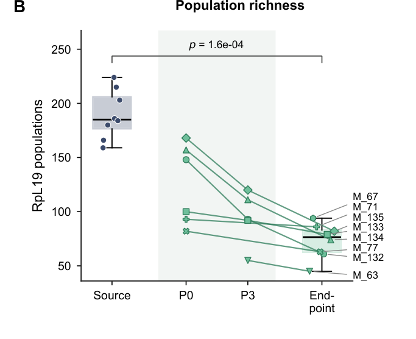](docs/img/fig1_richness.png)

*Number of RpL19 populations in the reservoir and in each enrichment lineage through its passages
(Fig 1B).*

The reservoir samples hold 159 to 224 populations and the enrichment end-points 45 to 94, and
richness fell through the passages of every lineage. Rank-abundance curves (Fig 1D) show the same
thing from another angle: the enrichments are dominated by a few populations, and in every
enrichment the most abundant one is a cyanobacterium.

[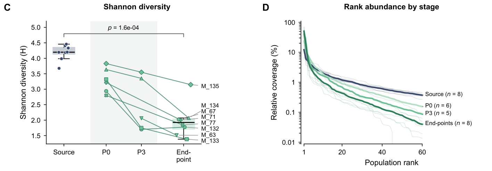](docs/img/fig1_diversity_rank.png)

*Shannon diversity (Fig 1C) and rank abundance by stage (Fig 1D).*

These numbers come from `taxonomy.py`, which writes them to `outputs/diversity_metrics.csv` and
`outputs/fig1_samples.csv`. To compute them yourself:

```python
cov = T.load_clusters()                 # 659 RpL19 clusters x 16 samples, mean coverage
div = T.diversity(cov)                  # richness, Shannon, share of the top three populations
div.groupby("group")[["richness", "shannon"]].agg(["min", "median", "max"])
```

```
           richness             shannon
                min median  max     min median   max
Enrichment       45   76.5   94    1.38   1.92  3.15
Source          159  185.0  224    3.68   4.20  4.46
```

### Convergence across taxonomic levels

The EcoPhylo heatmap is a good place to see the whole dataset at once: each column is an RpL19
population on the marker tree, each row a sample.

[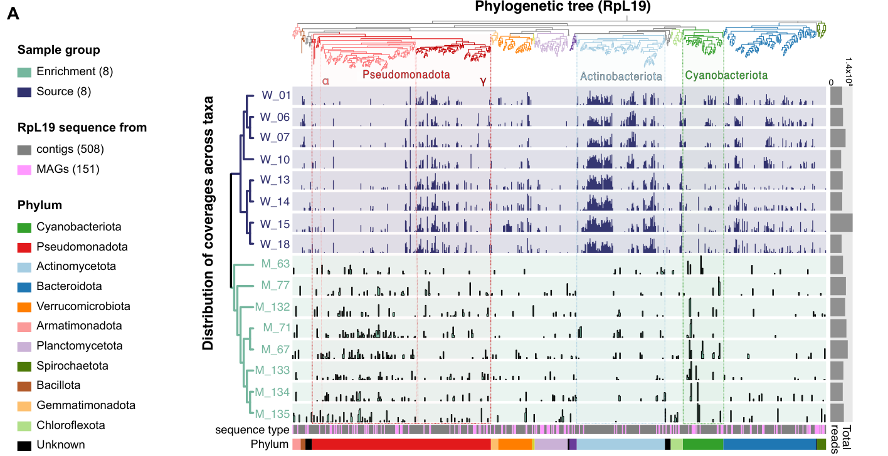](docs/img/fig2_ecophylo.png)

*RpL19 populations of reservoir and enrichment samples on the marker phylogeny (Fig 2A, drawn with
[anvi-interactive](https://anvio.org/help/main/programs/anvi-interactive/)).*

Almost no population is shared between enrichments, yet the enrichments look alike in broad
strokes. To make this precise, we sum populations at each taxonomic level and ask how much
relative coverage two samples share (one minus the Bray-Curtis dissimilarity), for the 28 pairs
of enrichments and the 28 pairs of reservoir samples:

[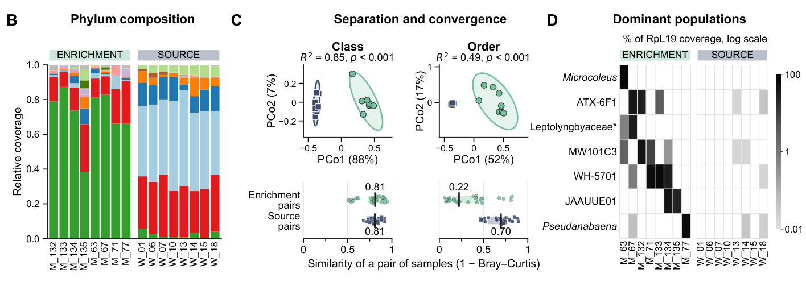](docs/img/fig2_convergence.png)

*Phylum composition (B), separation and convergence at the levels of class and order (C), and
the dominant populations of each enrichment (D) (Fig 2B-D).*

```python
conv = T.convergence_by_level()          # median pairwise Bray-Curtis at each level
conv["shared"] = 1 - conv["median"]
conv.pivot(index="level", columns="group", values="shared").round(2)
```

```
group               Enrichment  Source
level
phylum                    0.83    0.89
class                     0.81    0.81
order                     0.22    0.70
family                    0.19    0.66
genus                     0.06    0.61
population                0.03    0.53
function, coverage        0.81    0.85
function, count           0.90    0.92
```

At the level of class, pairs of enrichments share a median of 0.81 of their coverage, exactly as
much as pairs of reservoir samples do. At the level of order this drops to 0.22 (reservoir pairs
0.70), and at the level of populations to 0.03 (0.53). In other words, the enrichments converged
on the same classes but filled them with different orders, families and populations. Panel D
shows why: each enrichment is dominated by a different cyanobacterium (WH-5701, ATX-6F1,
*Microcoleus*, JAAUUE01, ...), and each of these was rare or undetected in the reservoir.

The same comparison at every level, and the corresponding ordinations, are in Supplementary
Figure S6:

[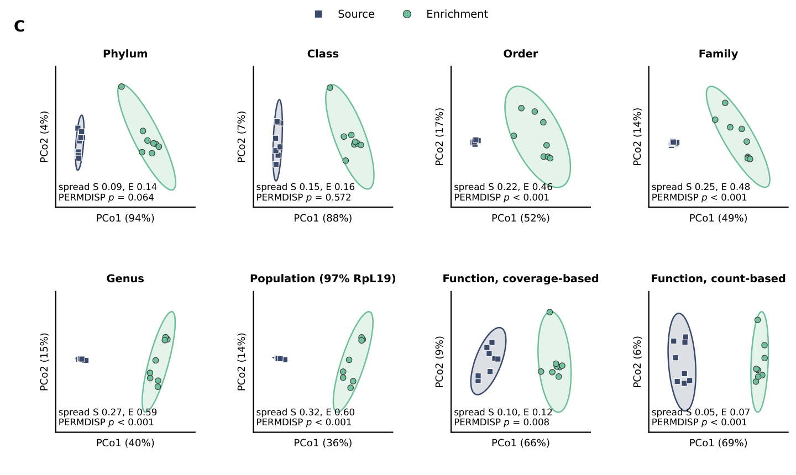](docs/img/si_pcoa_by_rank.png)

*Principal coordinates analysis of Bray-Curtis dissimilarities at every level (Supplementary
Figure S6C).*

Two notes on how unnamed populations are handled, because they carry up to a third of the
coverage in some enrichments. Clusters without a GTDB phylum take the phylum to family of the
nearest named tip on the marker tree (`common.place_on_tree`), and keep their own identity at
genus and below. Clusters placed further than 0.6 (patristic distance) from any named tip are
reported as unassigned. This matters in the media experiment, where one RpS16 cluster placed
inside the cyanobacteria turned out to be a eukaryotic plastid (reads from those cultures map to
no cyanobacterial genome).

### Metabolism on raw contigs: two metrics

For every module present in a sample (stepwise completeness ≥ 0.75, the default of
`anvi-estimate-metabolism`) we compute:

| metric | value | follows |
|---|---|---|
| coverage-based | `avg_coverage` | how abundant the carriers of a function are |
| count-based | `stepwise_copy_number / number of populations` | how widely the function is held across the community |

In code (`common.metric_matrices`, which also keeps only modules at stepwise completeness ≥ 0.75):

```python
npop = C.population_counts("enrichments", "rpl19")      # RpL19 clusters with coverage > 0
cov_m, cnt_m, names = C.metric_matrices("enrichments", "rpl19")
# inside metric_matrices:
#   cov = modules.pivot_table(index="module", columns="genome_name", values="avg_coverage")
#   cnt = modules.pivot_table(index="module", columns="genome_name", values="stepwise_copy_number")
#   cnt = cnt.div(npop, axis=1)                         # copies per population
cov_m.shape                                             # (235, 16)
```

Other denominators are available for comparison: `C.population_counts("enrichments", "rps16")`
and `"mags"` (detected MAGs).

The count-based metric is the per-population copy number of Veseli et al., with one difference:
the number of populations comes from EcoPhylo rather than from single-copy core genes, so that
"population" means the same thing in the taxonomic and the functional analyses. Pathway copy
numbers will naturally be higher in assemblies of larger communities, and the enrichments hold
two to three times fewer populations than the reservoir, so dividing by the number of populations
is what makes the two groups comparable.

Does the count-based metric really follow the number of genomes that carry a function? We can
check this with the MAGs:

[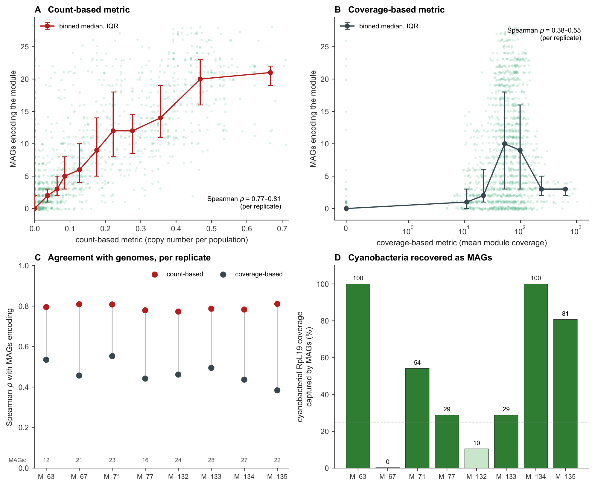](docs/img/si_count_vs_mags.png)

*Number of detected MAGs encoding each module against the two metrics (Supplementary Figure S15).*

It does: across modules, the number of encoding MAGs correlates with the count-based metric
(Spearman ρ = 0.77-0.81 per replicate) much more closely than with the coverage-based metric
(ρ = 0.38-0.55). A count-based value of 0.20 corresponds to about 11 encoding MAGs, and 0.40 to
about 17.

Before comparing samples on function, it is worth asking how similar they are overall:

[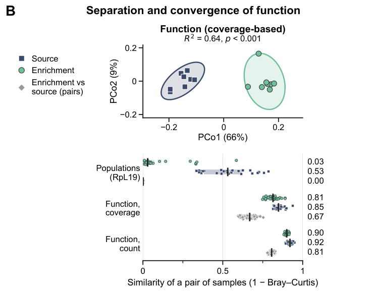](docs/img/fig3_function_pcoa.png)

*Function separates the enrichments from the reservoir (top), yet pairs of enrichments share
almost as much function as pairs of reservoir samples, unlike populations (bottom; Fig 3B).*

Pairs of enrichments share 0.81 of their module coverage and 0.90 of their pathway-copy profiles
(reservoir pairs 0.85 and 0.92), against 0.03 of their populations. Function converged where
populations did not. The ordination and its tests:

```python
groups = {"Source": C.SOURCE, "Enrichment": C.ENRICHMENT}
res = C.bray_pcoa(C.compositional(cov_m), groups)   # each sample divided by its total
res["R2"], res["p"], res["centroid_dist"]           # PERMANOVA R2 = 0.64, p = 0.0002; PERMDISP spread
```

`C.compositional` is used for ordinations only. The tests below keep raw coverage, so that the
coverage-based metric still follows abundance.

### Classifying modules by the two metrics

Each metric is compared between enrichments and reservoir, module by module, with a two-sided
Wilcoxon rank-sum test. With eight samples per group the normal approximation is poor when values
are tied, so we enumerate the null distribution exactly (all 12,870 ways of splitting 16 samples
into two groups of eight; `common.differential`). P values are adjusted with Benjamini-Hochberg
within each metric, and a module is increased on a metric at q < 0.05 and log2 fold change > 0.5.

```bash
cd analysis
python function.py
```

If everything went well, `outputs/table1_two_metric.csv` classifies 235 modules: 55 increased on
both metrics, 88 on the coverage-based metric only, 6 on the count-based metric only, and 86 on
neither. The same, step by step:

```python
cv = C.differential(cov_m, C.ENRICHMENT, C.SOURCE)   # exact rank-sum, BH within the metric
ct = C.differential(cnt_m, C.ENRICHMENT, C.SOURCE)
cls = C.niche_class(cv, ct)                          # q < 0.05 and log2FC > 0.5 on each metric
cls.value_counts()
names.reindex(cls[cls == "count-based only"].index).module_name
```

```
coverage-based only    88
neither                86
both metrics           55
count-based only        6
```

Each differential table has the fold change, exact and asymptotic p values, BH-adjusted q,
group means and `separated` (every value of one group outside the range of the other).

[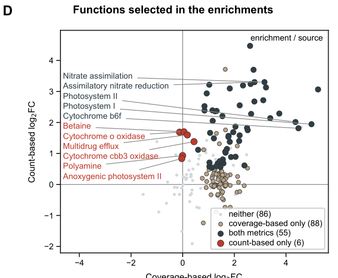](docs/img/fig3_two_metrics.png)

*Coverage-based against count-based log2 fold change for every module, coloured by class (Fig 3D).*

The modules increased on both metrics are what you would expect a medium without organic carbon
under light to impose: photosystems I and II, the cytochrome *b6f* complex, pigment and quinone
biosynthesis, and nitrate assimilation (the medium is nitrate-replete).

The six count-only modules are the interesting ones: anoxygenic photosystem II, the high-affinity
*cbb3*-type cytochrome *c* oxidase, cytochrome *o* ubiquinol oxidase, betaine biosynthesis,
polyamine biosynthesis and a multidrug efflux pump. Their copy numbers in the assemblies barely
changed (log2 fold change -0.4 to +0.5) while the number of populations fell 2.6-fold, so the
copies per population went up without any carrier becoming abundant. Several of these functions are
associated with low oxygen: *cbb3* oxidases work at nanomolar oxygen, and in most purple bacteria
anoxygenic photosynthesis is repressed by oxygen. Since these cultures grow as aggregates of oxygen-producing cyanobacteria, a
reasonable interpretation is that the aggregates create microoxic niches, a condition the
community made rather than one the medium imposed. This is an interpretation, not a measurement:
oxygen was not measured inside the aggregates.

How robust is this classification? `function.py` repeats it with other ways of counting
populations (RpS16, detected MAGs, an assembly-level estimate), with coverage normalised by
sequencing depth, and with the asymptotic test. Between 94% and 98% of modules keep their class
(Supplementary Table S6; `outputs/denominator_robustness.csv`). With few samples per group,
a pre-specified set of modules can also be tested as a set, which asks one question instead of
a few hundred:

```python
C.set_test(ct, set(C.ANOXIC_MODULES), "anoxic")
# {'n_in': 10, 'median_in': 1.48, 'median_out': 0.32, 'p': 0.013}  count-based log2FC, set vs rest
```

### Who encodes what: attribution with MAGs

The contig-level metrics say *what* changed, but not *who* carries it. For that we use the 88
MAGs: a MAG encodes a module at pathwise completeness ≥ 0.75, and is present in a sample at mean
read coverage ≥ 1. For each module and sample, the coverage of the encoding MAGs is split between
cyanobacteria and everything else.

One detail that matters a lot: MAG coverage is linked to each MAG **by sequence**
(`pipeline/05_link_mags_to_bins.py`, more than 90% bidirectional overlap of contig names with the
source bin), never by matching genus names. An earlier version of this analysis matched by name and
got several attributions wrong.

[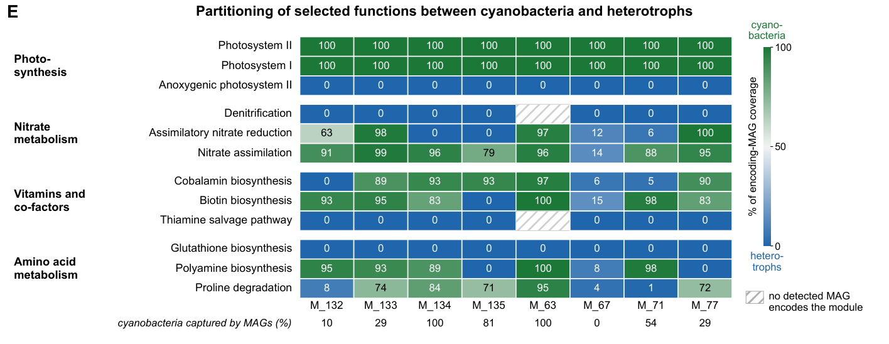](docs/img/fig3_partition.png)

*Share of the coverage of encoding MAGs that belongs to cyanobacteria (green) or other bacteria
(blue), for twelve selected modules in each enrichment (Fig 3E). The bottom row gives the
fraction of cyanobacterial RpL19 coverage captured by MAGs.*

Some functions belong to one partner everywhere: photosystems I and II are always cyanobacterial,
while denitrification, thiamine salvage, glutathione biosynthesis and anoxygenic photosystem II are
always heterotrophic. Others switch. Cobalamin biosynthesis is cyanobacterial in five enrichments
and heterotrophic in M_67, M_71 and M_132; biotin biosynthesis is cyanobacterial except in M_135,
whose dominant cyanobacterium lacks the pathway, so heterotrophs (different ones in different
replicates) carry it there. Which partner provides a cofactor depends on which cyanobacterium
happened to win.

```python
dol = F.division_of_labour()             # module x replicate: % of encoder coverage that is cyanobacterial
dol.pivot(index="module", columns="sample", values="cyano_percent").round(0)
comp, mag_cov, tax = C.mag_tables()      # the MAG tables behind it, linked by sequence
```

An empty cell means that no detected MAG encodes the module in that replicate, which is not
the same as 0% cyanobacterial.

Keep the bottom row in mind when reading this panel: in M_67 the dominant cyanobacterium was not
recovered as a MAG, so the attribution there describes only a minority of the cyanobacteria. The
encoding MAGs for each module and replicate are listed in Supplementary Table S4
(`outputs/s4_per_replicate_carriers.csv`).

### The media experiment

The second experiment asks whether changing the imposed niche changes the outcome. `media.py`
runs the same analyses on the 13 P10 cultures (one NV culture is excluded: it held only two
bacterial populations beside a eukaryotic phototroph), with RpS16 as the marker.

[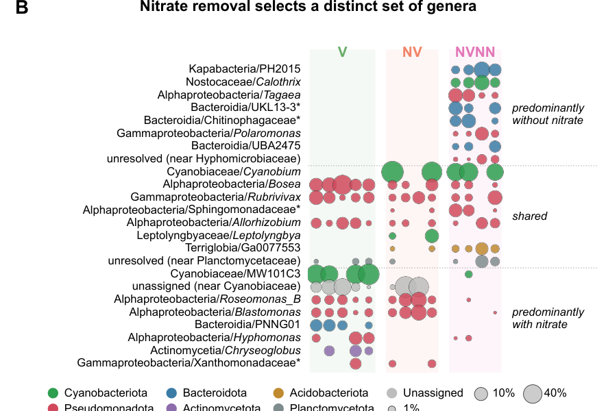](docs/img/fig4_genera.png)

*Relative coverage of the genera that distinguish the three media (Fig 4B).*

Without nitrate, the heterocystous diazotroph *Calothrix* appears, together with heterotrophs that
are nearly absent elsewhere, notably PH2015 (class Kapabacteria), *Tagaea* and *Polaromonas*, each
present in all four NVNN cultures.

[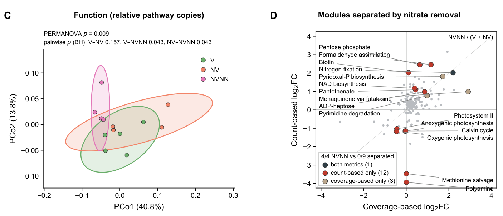](docs/img/fig4_media.png)

*Ordination of relative pathway copies (C) and the modules that separate NVNN from the
nitrate-replete cultures (D) (Fig 4C-D).*

The pathway-copy profiles of NVNN differ from those of V and NV (adjusted p = 0.043 in each case),
while V and NV do not differ. No module differs between V and NV on either metric, so NVNN is
compared with the nine nitrate-replete cultures pooled:

```python
out, mcov, mcnt, mnames = M.contrasts("rps16")     # RpS16 populations as the denominator
cnt = out["nitrate"]["cnt"]                        # NVNN against V + NV, count-based metric
sig = cnt[cnt.padj < C.FDR]
len(sig), (sig.l2fc > 0).sum()                     # 13 modules, 7 of them higher without nitrate
cnt.loc["M00175", ["l2fc", "padj"]]                # nitrogen fixation: log2FC 2.0, q = 0.039
out["nitrate"]["cov"].loc["M00175", "padj"]        # coverage-based: largest increase, q = 0.10
```

On the count-based metric 13 modules differ: seven are more widely represented without nitrate,
among them nitrogen fixation (encoded by *Calothrix* alone) and biotin biosynthesis, and six
less widely, among them photosystem II and the Calvin cycle. On the coverage-based metric
nitrogen fixation shows the largest increase, but with four cultures against nine no module
passes the FDR correction. The other two contrasts are `out["vitamin"]` (V against NV) and
`out["nvnn_vs_nv"]`.

Who carries each function across all passages comes from the shared genome reference of Part I:

```python
cov_g, enc, phylum, aln = M.shared_reference()     # genome x sample coverage, module encoding, phylum
share, tests, community, p = M.partition_test()    # Fig 4E: cyanobacterial share of encoder coverage
tests.sort_values("p").head()                      # per module, NVNN against V + NV, exact test, BH
# modules need an encoder in >= 3 cultures of each group, so nitrogen fixation (NVNN only) is not tested
```

### Generating the figures

```bash
python figures.py
```

This writes `outputs/FIG1.pdf` to `FIG4.pdf`, complete. Each panel is also written on its
own by the module that computes it (`outputs/fig1.pdf`, ..., and `outputs/si/` for the
supplementary figures). The EcoPhylo heatmaps and the hand-drawn
schematics are placed into the composites as vector crops from `data/schematics/`; every other
panel is drawn from the tables.


## Applying the two metrics to your own metagenomes

You need, for each sample, the output of `anvi-estimate-metabolism` (as above) and a number of
populations. Any consistent count works: EcoPhylo clusters, as here, or the number of genomes
estimated from single-copy core genes, as in Veseli et al.

```bash
# populations.tsv: sample<TAB>number of populations
# groups.tsv:      sample<TAB>group
python analysis/two_metrics.py --modules kegg/*_modules.txt \
                               --populations populations.tsv \
                               --groups groups.tsv \
                               --test TREATED --reference CONTROL \
                               --out two_metrics_results
```

This writes both metric matrices, the two differential tables and the class of every module. Run
on `data/kegg_modules_enrichments.csv` with our population counts, it reproduces the 55 / 88 / 6 /
86 classes above.

A few notes:

* With four to eight samples per group, an exact rank-sum test has little power once corrected for
  a few hundred modules. Classes from small designs are best read as rankings, and set-level tests
  (`common.set_test`) are more informative.
* The coverage-based metric is deliberately not normalised by sequencing depth, so that the two
  metrics stay distinct; normalising it changed 1.7% of classes in our data (Table S6). If your
  samples differ greatly in depth, check this yourself.
* A count-only module is a candidate, not a conclusion. In our case the oxygen interpretation is
  testable with microsensors, and we would be happy to hear if you test it in your system.
